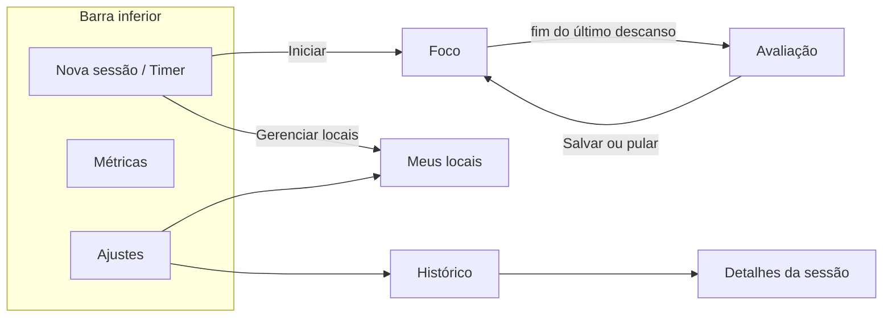
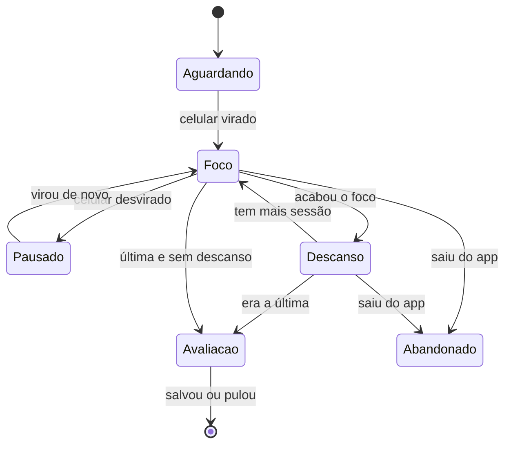
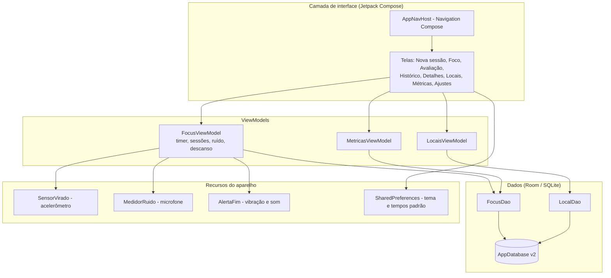

# FocusApp

Aplicativo Android nativo (Kotlin + Jetpack Compose) que ajuda estudantes a manterem o foco. O celular é virado com a tela para baixo para iniciar uma sessão de estudo no estilo Pomodoro, o app mede o ruído do ambiente e, no fim, o estudante avalia como foi. Com o histórico, o app mostra onde e quando ele rende mais.

Projeto Final (AP2) da disciplina **RUS0291 – Desenvolvimento de Software para Dispositivos Móveis**, Universidade Federal do Ceará (UFC) – Campus Russas.

**Equipe:** William Lavor e Marina

---

## Funcionalidades

- **Nova sessão:** matéria, quantidade de sessões (1 a 10), minutos de foco e de descanso livres e local de estudo.
- **Foco com o celular virado:** o acelerômetro detecta a tela para baixo (com ~2 s de estabilidade) e inicia o cronômetro. Desvirar pausa, virar de novo retoma.
- **Várias sessões em sequência:** foco → descanso → foco... A próxima sessão começa sozinha se o celular continuar virado. A avaliação vem só uma vez, depois do último foco e do último descanso.
- **Ruído do ambiente:** o microfone mede o nível de ruído (dB relativo) durante o foco: média, pico, mínimo e quantidade de picos.
- **Avaliação:** de 1 a 5 estrelas e fatores que influenciaram (silêncio, cansaço, celular, conforto, iluminação).
- **Alerta de fim:** vibra e toca o som do aparelho quando o foco ou o descanso acaba.
- **Histórico:** busca por matéria e filtros por período e por local; detalhes com edição de matéria, anotações e avaliação; exclusão com confirmação.
- **Locais:** cadastro, edição e exclusão dos locais de estudo (escolhidos manualmente, sem GPS).
- **Métricas:** janela de 7 dias, 30 dias ou tudo; gráfico dos últimos 7 dias; melhor local; ranking dos locais (com detalhes de cada um, mesmo sem sessões) e das matérias; relação entre ruído e nota.
- **Meta diária e sequência:** progresso do dia e dias seguidos estudando, na tela principal.
- **Ajustes:** tema claro/escuro, minutos padrão de foco e descanso, meta diária, atalhos e opção de apagar o histórico.

Tudo funciona offline, com os dados guardados no aparelho.

---

## Fluxo de telas



A barra de navegação só aparece nas três telas principais. Durante o foco, a avaliação, os locais, o histórico e os detalhes ela fica escondida.

### Fluxo de uma sessão



Se o app sai da tela no meio do estudo, a sessão é salva como `ABANDONADO`, com os minutos realmente estudados.

---

## Arquitetura



- **UI:** só desenha e repassa eventos. O estado do timer fica no `FocusViewModel`, que é compartilhado entre Nova sessão, Foco e Avaliação (escopo da Activity), então sobrevive à troca de tela.
- **Cálculos puros:** métricas, filtros, estatísticas e validações são funções simples (`ui/metricas`, `ui/history/FiltroHistorico.kt`, `ui/focus/Validacao.kt`), por isso são testadas sem emulador.
- **Dados:** duas entidades Room, `FocusSession` e `Local`. O status da sessão é o `enum` `StatusSessao`, salvo como texto.

### Estrutura de pastas

```text
com.example.focusapp
├── MainActivity.kt
├── alerta/        AlertaFim (vibra e toca)
├── data/          FocusSession, Local, DAOs, AppDatabase, StatusSessao
├── navigation/    NavRoutes, AppNavHost (rotas e barra inferior)
├── sensor/        SensorVirado, MedidorRuido
└── ui/
    ├── ajustes/   AjustesScreen, Preferencias
    ├── avaliacao/ AvaliacaoScreen
    ├── componentes/ EstadoVazio
    ├── details/   DetailScreen
    ├── focus/     FocusScreen, FocusViewModel, AnelTempo, Validacao
    ├── history/   HistoryScreen, FiltroHistorico
    ├── locais/    LocaisScreen, LocaisViewModel
    ├── metricas/  MetricasScreen, Metricas, Estatisticas, GraficoSemana
    ├── ruido/     PainelRuido
    ├── sessao/    NovaSessaoScreen, ResumoDoDia
    └── theme/     cores, tipografia e tema
```

---

## Sensores e recursos do aparelho

### Acelerômetro (`SensorVirado`)

Detecta o celular com a tela para baixo usando três condições:

- **Orientação:** o eixo Z chega perto de -9 m/s².
- **Estabilidade:** a aceleração total fica próxima da gravidade (aparelho parado).
- **Permanência:** a posição se mantém por cerca de 2 segundos, evitando disparos sem querer.

Ao sair da posição existe uma folga (histerese) para a detecção não ficar oscilando. O sensor é registrado quando o app aparece e liberado quando ele sai da tela.

### Microfone (`MedidorRuido`)

- A permissão `RECORD_AUDIO` é pedida em tempo de execução.
- A leitura usa `AudioRecord`, em corrotina fora da thread principal.
- Cada pedaço de áudio vira um valor RMS, convertido em decibéis, a cada ~500 ms.
- O app guarda média, pico, mínimo e quantos picos passaram do limite de barulho (60 dB).

**Atenção:** os dB são **relativos**. O celular não é calibrado como um decibelímetro profissional, então o valor serve para comparar ambientes e sessões entre si, não como medida absoluta.

### Alerta de fim (`AlertaFim`)

Vibra e toca o toque padrão quando o foco ou o descanso termina. Usa a permissão `VIBRATE`.

---

## Cronômetro

A contagem usa `SystemClock.elapsedRealtime()` e o instante previsto de término, não um contador que vai subtraindo. Assim a pausa, a retomada e o relógio do aparelho não distorcem o tempo.

---

## Banco de dados (Room)

| Entidade | Campos principais |
|---|---|
| `FocusSession` | `id`, `materia`, `data`, `duracaoMinutos`, `status`, `mediaDb`, `picoDb`, `minDb`, `notas`, `avaliacao`, `fatores`, `localId` |
| `Local` | `id`, `nome`, `descricao` |

- Uma sessão guarda o estudo inteiro: com 3 sessões de 25 min, o registro tem 75 min.
- Apagar um local não apaga as sessões, que só ficam "sem local".
- O banco está na **versão 2**, sem migrações. Se algum aparelho ainda tiver a versão 1, é preciso desinstalar e instalar de novo.
- As preferências simples (tema, tempos padrão e meta diária) ficam em `SharedPreferences`.

---

## Como rodar

1. Abra a pasta do projeto no Android Studio.
2. Aguarde o Gradle sincronizar.
3. Rode em um celular real (o acelerômetro e o microfone não funcionam bem no emulador).
4. Aceite a permissão do microfone na primeira sessão.

Requisitos: Android 8.0 (API 26) ou superior.

### Testes

```bash
./gradlew test
```

Os testes unitários cobrem as métricas por local, matéria e dia, a sequência de dias, o insight de ruído, o filtro do histórico, a validação dos minutos, o formato do tempo e o rótulo do status.

---

## Ferramentas e bibliotecas

| Tecnologia | Uso |
|---|---|
| Kotlin | Linguagem principal |
| Jetpack Compose + Material 3 | Interface |
| Navigation Compose | Navegação e barra inferior |
| ViewModel + Coroutines | Estado e tarefas assíncronas |
| Room + KSP | Persistência local |
| SensorManager | Acelerômetro |
| AudioRecord | Captura do microfone |
| JUnit | Testes unitários |
| Gradle Kotlin DSL | Build |

---

## Limitações conhecidas

- Com o app fora da tela (Home ou troca de app), o estudo é abandonado. Com a tela apagada pelo botão de ligar, o comportamento depende do sistema, porque o acelerômetro e o microfone não rodam em segundo plano.
- Não há notificação nem serviço em primeiro plano.
- Não existe login nem sincronização na nuvem: os dados ficam só no aparelho.
- O local de estudo é escolhido manualmente (sem GPS).
