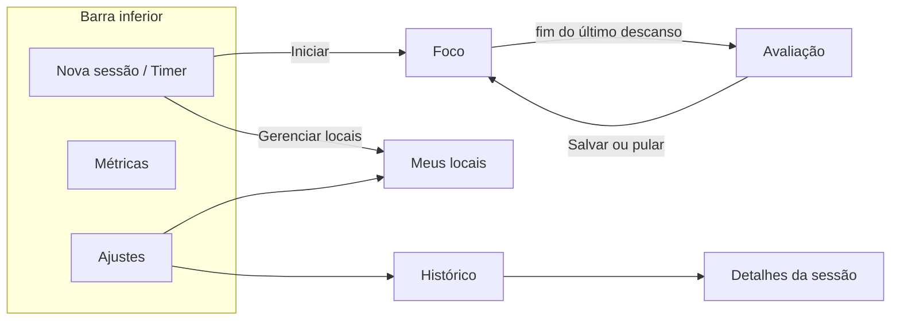
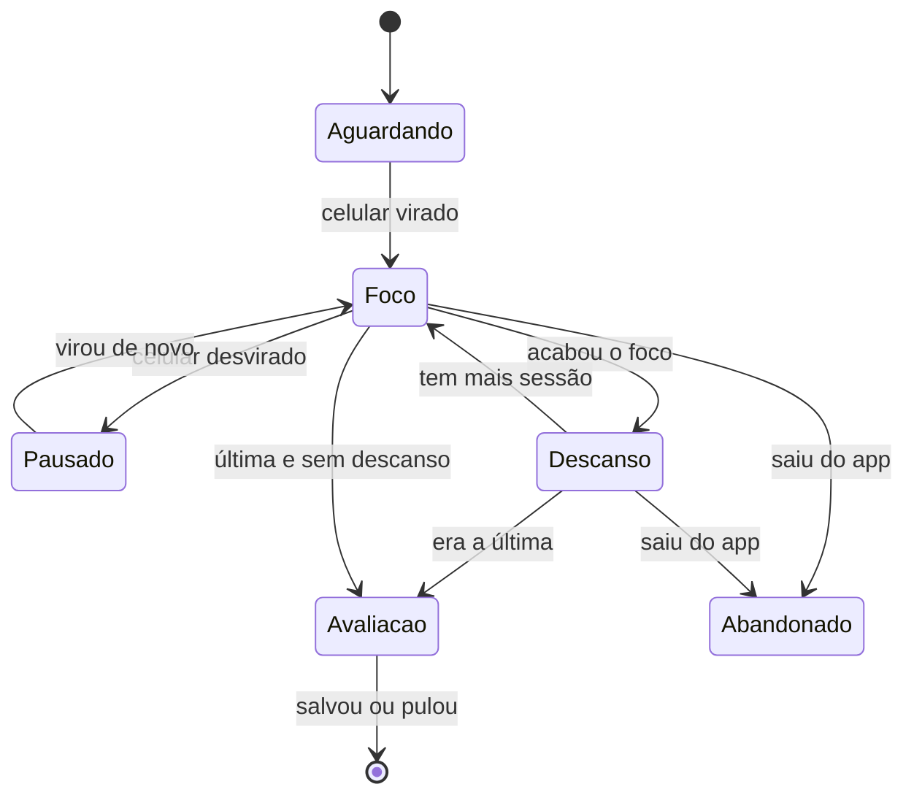
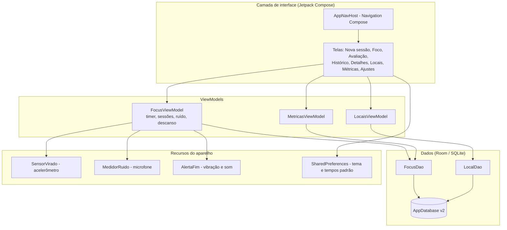

# FocusApp

App Android nativo (Kotlin e Jetpack Compose) para ajudar estudantes a manter o foco. Para começar uma sessão de estudo no estilo Pomodoro, o celular é virado com a tela para baixo. Durante o foco o app mede o barulho do ambiente e, no fim, o estudante avalia como foi. Com o histórico, dá para ver onde e quando o rendimento é melhor.

Projeto final (AP2) da disciplina de desenvolvimento de software para dispositivos móveis, UFC Russas.

Equipe: William Sousa Lavor(556973) e Marina de Lima Freire(557548)

---

## Funcionalidades

- Nova sessão: matéria, número de sessões (1 a 10), minutos de foco e de descanso livres e local de estudo.
- Foco com o celular virado: o acelerômetro detecta a tela para baixo (estável por cerca de 2 s) e o cronômetro começa. Desvirar pausa e virar de novo retoma.
- Várias sessões em sequência: foco, descanso, foco e assim por diante. A próxima começa sozinha se o celular continuar virado. A avaliação vem uma vez só, depois do último foco e do último descanso.
- Ruído do ambiente: durante o foco o microfone mede o nível de ruído em dB relativo (média, pico, mínimo e quantidade de picos).
- Avaliação: de 1 a 5 estrelas e fatores que influenciaram (silêncio, cansaço, celular, conforto, iluminação).
- Alerta de fim: vibração e som quando o foco ou o descanso termina.
- Histórico: busca por matéria, filtros por período e local, edição de matéria, notas e avaliação nos detalhes, e exclusão com confirmação.
- Locais: cadastro, edição e exclusão dos locais de estudo, escolhidos à mão (sem GPS).
- Métricas: janela de 7 dias, 30 dias ou tudo; gráfico dos últimos 7 dias; melhor local; ranking de locais e de matérias; relação entre ruído e nota.
- Meta diária e sequência de dias estudando, na tela principal.
- Ajustes: tema claro ou escuro, minutos padrão, meta diária e opção de apagar o histórico.

Tudo funciona offline, com os dados guardados no aparelho.

---

## Fluxo de telas



A barra de navegação só aparece nas três telas principais e fica escondida no foco, na avaliação, nos locais, no histórico e nos detalhes.

### Fluxo de uma sessão



Se o app sai da tela no meio do estudo, a sessão é salva como `ABANDONADO`, com os minutos que foram estudados.

---

## Arquitetura



- UI: só desenha e repassa os eventos. O estado do timer fica no `FocusViewModel`, compartilhado entre Nova sessão, Foco e Avaliação (escopo da Activity), então sobrevive à troca de tela.
- Cálculos puros: métricas, filtros, estatísticas e validações são funções simples (`ui/metricas`, `ui/history/FiltroHistorico.kt`, `ui/focus/Validacao.kt`), por isso dá para testá-las sem emulador.
- Dados: duas entidades Room, `FocusSession` e `Local`. O status da sessão é o `enum` `StatusSessao`, salvo como texto.

### Estrutura de pastas

```text
com.example.focusapp
├── MainActivity.kt
├── alerta/        AlertaFim (vibra e toca)
├── data/          FocusSession, Local, DAOs, AppDatabase, StatusSessao
├── navigation/    NavRoutes, AppNavHost (rotas e barra inferior)
├── sensor/        SensorVirado, MedidorRuido
└── ui/
    ├── ajustes/   AjustesScreen, Preferencias
    ├── avaliacao/ AvaliacaoScreen
    ├── componentes/ EstadoVazio
    ├── details/   DetailScreen
    ├── focus/     FocusScreen, FocusViewModel, AnelTempo, Validacao
    ├── history/   HistoryScreen, FiltroHistorico
    ├── locais/    LocaisScreen, LocaisViewModel
    ├── metricas/  MetricasScreen, Metricas, Estatisticas, GraficoSemana
    ├── ruido/     PainelRuido
    ├── sessao/    NovaSessaoScreen, ResumoDoDia
    └── theme/     cores, tipografia e tema
```

---

## Sensores e recursos do aparelho

### Acelerômetro (`SensorVirado`)

O celular é considerado virado quando três condições se cumprem:

- o eixo Z fica perto de -9 m/s²;
- a aceleração total fica próxima da gravidade, ou seja, o aparelho está parado;
- a posição se mantém por cerca de 2 segundos.

Para sair da posição existe uma folga, assim a detecção não fica oscilando na borda. O sensor é registrado quando o app aparece e liberado quando ele sai da tela.

### Microfone (`MedidorRuido`)

- A permissão `RECORD_AUDIO` é pedida em tempo de execução. Se for negada, o app segue funcionando, só sem a medição de ruído.
- A leitura usa `AudioRecord`, numa corrotina fora da thread principal.
- A cada 500 ms, o áudio lido vira um valor RMS e depois decibéis.
- Guardamos média, pico, mínimo e quantos picos passaram de 60 dB. **Nenhum áudio é gravado.**

Os dB são relativos.

### Alerta de fim (`AlertaFim`)

Vibra e toca o som padrão do aparelho quando o foco ou o descanso acaba. Usa a permissão `VIBRATE`.

---

## Cronômetro

A contagem guarda o instante previsto de término com `SystemClock.elapsedRealtime()` e calcula o tempo restante a partir dele, em vez de ir subtraindo segundos. Assim um atraso no loop não acumula erro.

---

## Banco de dados (Room)

| Entidade | Campos principais |
|---|---|
| `FocusSession` | `id`, `materia`, `data`, `duracaoMinutos`, `status`, `mediaDb`, `picoDb`, `minDb`, `notas`, `avaliacao`, `fatores`, `localId` |
| `Local` | `id`, `nome`, `descricao` |

- Um registro guarda o estudo inteiro: 3 sessões de 25 min viram uma sessão de 75 min.
- Apagar um local não apaga as sessões, que ficam sem local.
- Tema, tempos padrão e meta diária ficam em `SharedPreferences`.

---

## Como rodar

1. Abrir a pasta do projeto no Android Studio.
2. Esperar o Gradle sincronizar.
3. Rodar em um celular de verdade, porque o acelerômetro e o microfone não funcionam bem no emulador.
4. Aceitar a permissão do microfone na primeira sessão.

Requer Android 8.0 (API 26) ou superior.

### Testes

```bash
./gradlew test
```

Os testes unitários cobrem as métricas (por local, matéria e dia), a sequência de dias, o filtro do histórico, a validação dos minutos, o formato do tempo e o rótulo do status.

---

## Tecnologias

| Tecnologia | Uso |
|---|---|
| Kotlin | Linguagem |
| Jetpack Compose e Material 3 | Interface |
| Navigation Compose | Navegação e barra inferior |
| ViewModel e Coroutines | Estado e tarefas assíncronas |
| Room e KSP | Banco local |
| SensorManager | Acelerômetro |
| AudioRecord | Microfone |
| JUnit | Testes unitários |
| Gradle Kotlin DSL | Build |

---

## Limitações

- Se o app sai da tela (Home ou troca de app), o estudo é abandonado. Com a tela apagada pelo botão de ligar o resultado depende do sistema, porque os sensores não rodam em segundo plano.
- Não há notificação nem serviço em primeiro plano.
- Não há login nem sincronização na nuvem. Os dados ficam só no aparelho.
- O local de estudo é escolhido manualmente.
